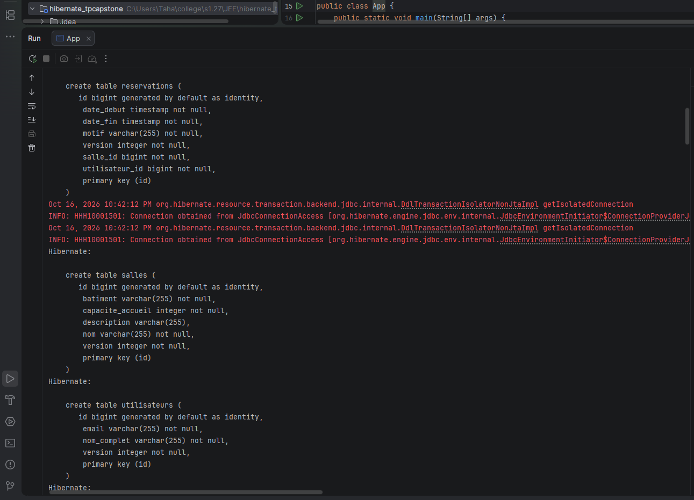
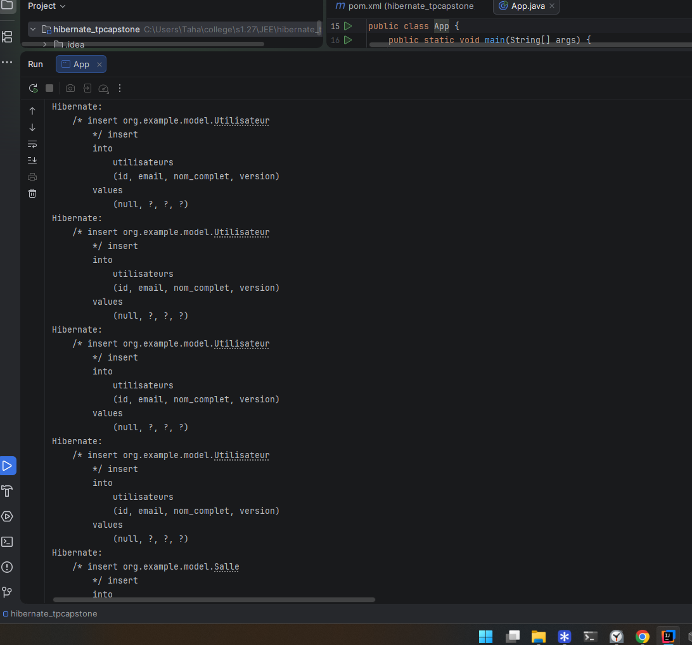
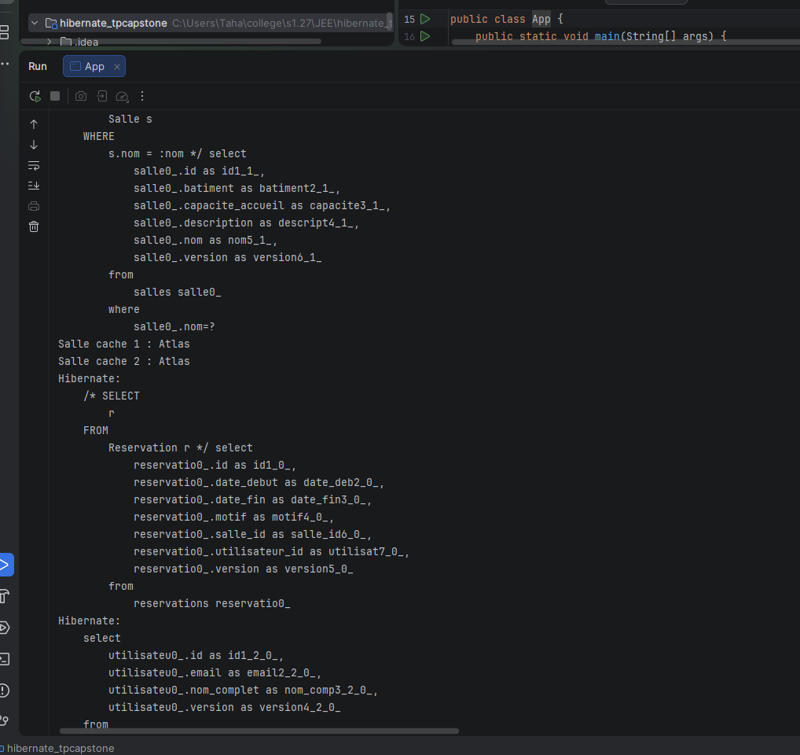
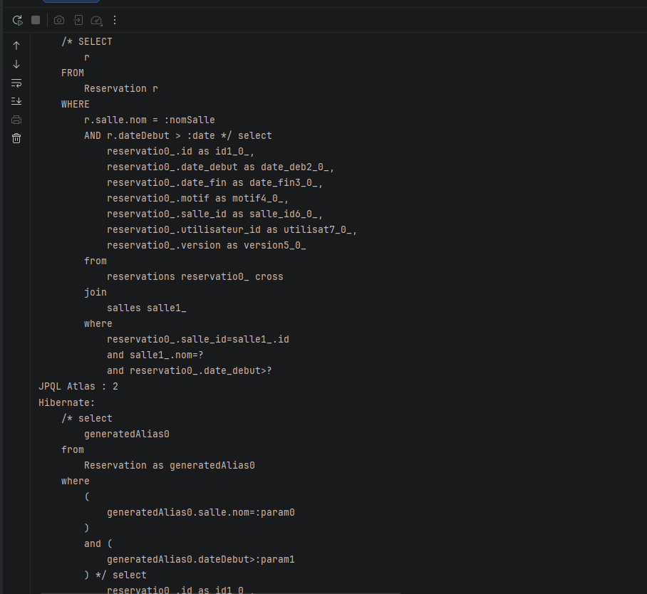
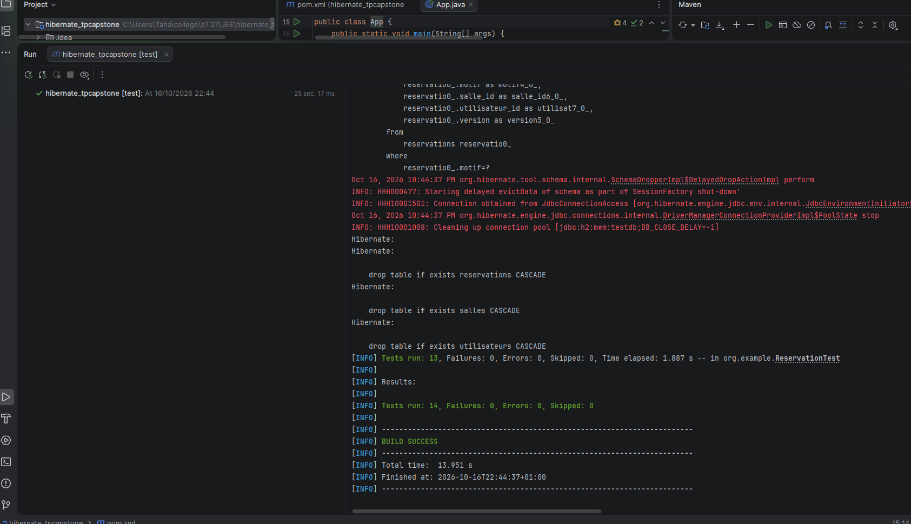

Execution de App (demarrage + creation des tables) :

```console
INFO: HHH000204: Processing PersistenceUnitInfo [name: ReservationPU]
INFO: HHH000412: Hibernate ORM core version 5.4.30.Final
INFO: HHH10001005: using driver [org.h2.Driver] at URL [jdbc:h2:mem:testdb;DB_CLOSE_DELAY=-1]
INFO: HHH000400: Using dialect: org.hibernate.dialect.H2Dialect
Hibernate: drop table if exists reservations CASCADE
Hibernate: drop table if exists salles CASCADE
Hibernate: drop table if exists utilisateurs CASCADE
Hibernate: create table reservations (id bigint generated by default as identity, date_debut timestamp not null, date_fin timestamp not null, motif varchar(255) not null, version integer not null, salle_id bigint not null, utilisateur_id bigint not null, primary key (id))
Hibernate: create table salles (id bigint generated by default as identity, batiment varchar(255) not null, capacite_accueil integer not null, description varchar(255), nom varchar(255) not null, version integer not null, primary key (id))
Hibernate: create table utilisateurs (id bigint generated by default as identity, email varchar(255) not null, nom_complet varchar(255) not null, version integer not null, primary key (id))
Hibernate: alter table salles add constraint UK_baqiyi6ypsidfq05qu8l9o2w9 unique (nom)
Hibernate: alter table utilisateurs add constraint UK_6ldvumu3hqvnmmxy1b6lsxwqy unique (email)
Hibernate: alter table reservations add constraint FK11c2598mdsm9g395pl5ubdvi3 foreign key (salle_id) references salles
Hibernate: alter table reservations add constraint FK5jh2b3gs43v5mdq0ocumvv34p foreign key (utilisateur_id) references utilisateurs
```



Insertion du jeu de donnees, 4 utilisateurs et 3 salles puis 4 reservations :

```console
Hibernate: insert into utilisateurs (id, email, nom_complet, version) values (null, ?, ?, ?)
Hibernate: insert into utilisateurs (id, email, nom_complet, version) values (null, ?, ?, ?)
Hibernate: insert into utilisateurs (id, email, nom_complet, version) values (null, ?, ?, ?)
Hibernate: insert into utilisateurs (id, email, nom_complet, version) values (null, ?, ?, ?)
Hibernate: insert into salles (id, batiment, capacite_accueil, description, nom, version) values (null, ?, ?, ?, ?, ?)
Hibernate: insert into salles (id, batiment, capacite_accueil, description, nom, version) values (null, ?, ?, ?, ?, ?)
Hibernate: insert into salles (id, batiment, capacite_accueil, description, nom, version) values (null, ?, ?, ?, ?, ?)
Hibernate: insert into reservations (id, date_debut, date_fin, motif, salle_id, utilisateur_id, version) values (null, ?, ?, ?, ?, ?, ?)
Hibernate: insert into reservations (id, date_debut, date_fin, motif, salle_id, utilisateur_id, version) values (null, ?, ?, ?, ?, ?, ?)
Hibernate: insert into reservations (id, date_debut, date_fin, motif, salle_id, utilisateur_id, version) values (null, ?, ?, ?, ?, ?, ?)
Hibernate: insert into reservations (id, date_debut, date_fin, motif, salle_id, utilisateur_id, version) values (null, ?, ?, ?, ?, ?, ?)
```



Lecture de la meme salle sur 2 sessions, la seconde passe par le cache L2 :

```console
Hibernate: select salle0_.id, salle0_.batiment, salle0_.capacite_accueil, salle0_.description, salle0_.nom, salle0_.version from salles salle0_ where salle0_.nom=?
Salle cache 1 : Atlas
Salle cache 2 : Atlas
Hibernate: select reservatio0_.id, reservatio0_.date_debut, reservatio0_.date_fin, reservatio0_.motif, reservatio0_.salle_id, reservatio0_.utilisateur_id, reservatio0_.version from reservations reservatio0_
Cours Python : Atlas / Yassine El Fassi
Reunion projet : Sahara / Salma Bennani
Formation JEE : Ourika / Mehdi Tazi
Soutenance : Atlas / Nadia Chraibi
```



Requetes JPQL et Criteria sur Atlas plus rapport de performance :

```console
Hibernate: select reservatio0_.id, reservatio0_.date_debut, reservatio0_.date_fin, reservatio0_.motif, reservatio0_.salle_id, reservatio0_.utilisateur_id, reservatio0_.version from reservations reservatio0_ cross join salles salle1_ where reservatio0_.salle_id=salle1_.id and salle1_.nom=? and reservatio0_.date_debut>?
JPQL Atlas : 2
Hibernate: select reservatio0_.id, reservatio0_.date_debut, reservatio0_.date_fin, reservatio0_.motif, reservatio0_.salle_id, reservatio0_.utilisateur_id, reservatio0_.version from reservations reservatio0_ inner join salles salle1_ on reservatio0_.salle_id=salle1_.id where salle1_.nom=? and reservatio0_.date_debut>?
Criteria Atlas : 2
=== Rapport performance ===
Requetes : 4
L2 hits : 1
L2 miss : 6
L2 puts : 11
Transactions : 1
Duree max requete (ms) : 31
```



Tests JUnit, les 13 scenarios passent :

```console
Tests run: 13, Failures: 0, Errors: 0, Skipped: 0 -- in org.example.ReservationTest
Tests run: 14, Failures: 0, Errors: 0, Skipped: 0
BUILD SUCCESS
```


